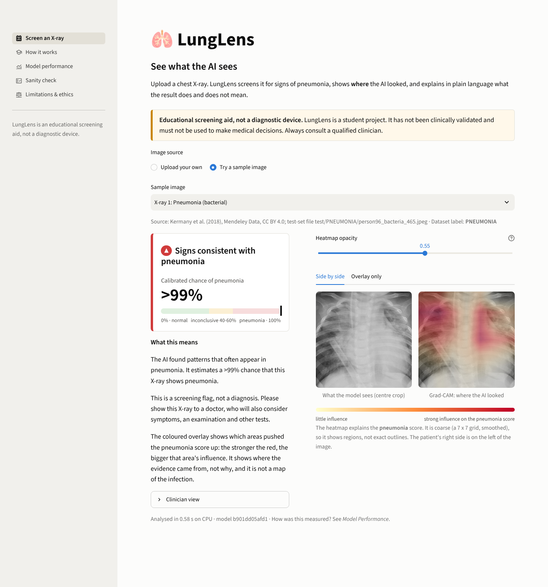
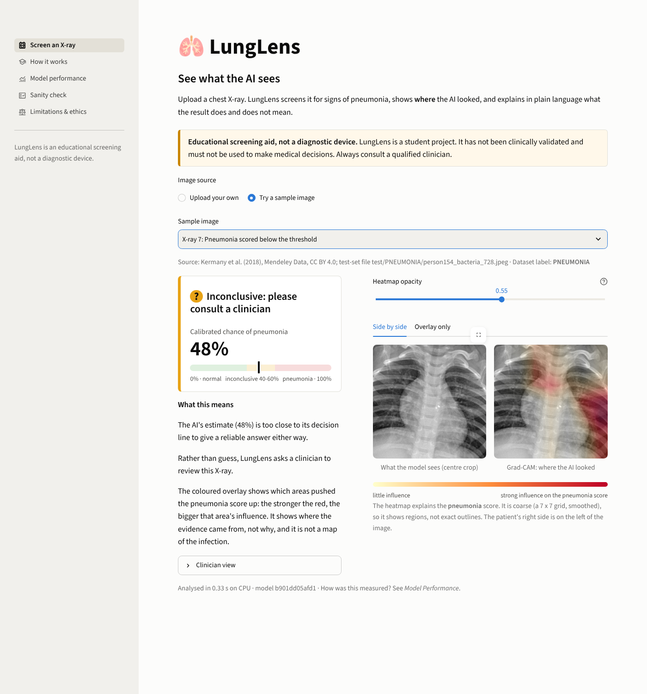
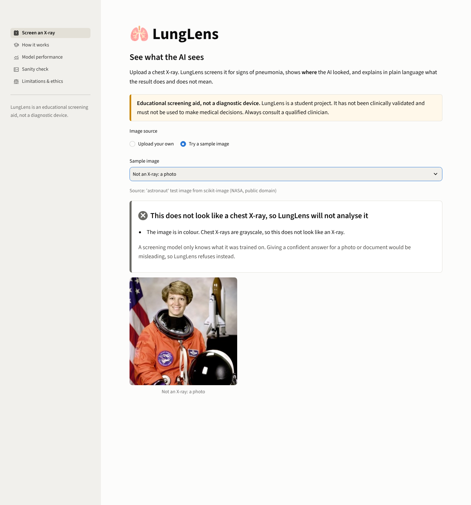
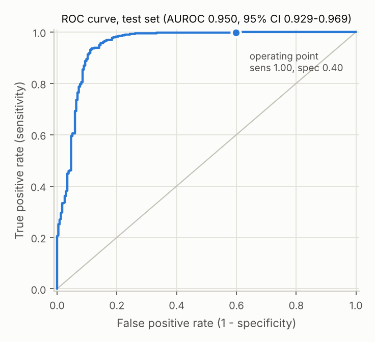
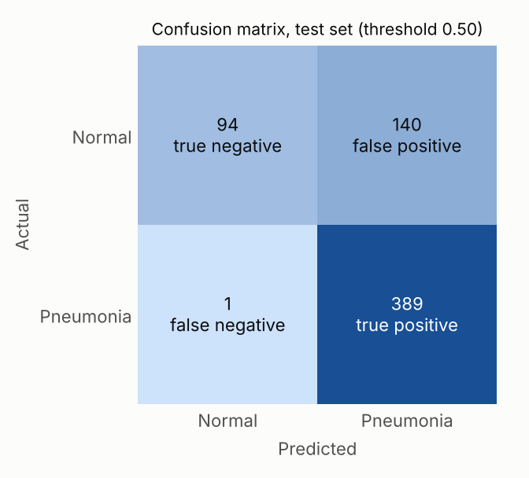
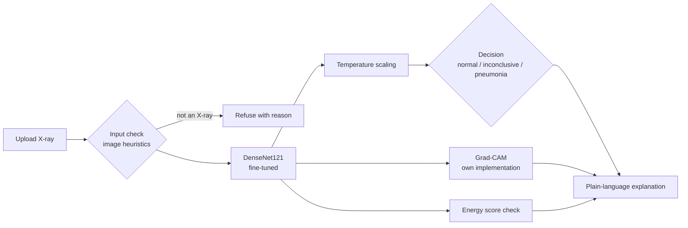

# LungLens: See what the AI sees


**Explainable chest X-ray screening for earlier pneumonia detection.** Built for the UnivaBio student
hackathon (theme: *Artificial Intelligence for Human Health*, hosted by BioCataalysis and UnivaDev).

Upload a chest X-ray and LungLens returns:

1. a **Normal / Pneumonia / Inconclusive** screening result with a **calibrated** probability,
2. a **Grad-CAM heatmap** showing which regions drove the prediction,
3. a **plain-language explanation** of what the result does and does not mean.

> **Educational screening aid, not a diagnostic device.** Trained on pediatric X-rays from a single
> hospital and not externally validated. Do not use it for medical decisions.

| Pneumonia flagged | Inconclusive: please consult a clinician | Not a chest X-ray: refused |
|---|---|---|
|  |  |  |

More screenshots: [Model performance](docs/screenshots/page_model_performance.png) ·
[Sanity check](docs/screenshots/page_sanity_check.png) · [Clinician view](docs/screenshots/screen_clinician_view.png) ·
[Phone](docs/screenshots/mobile.png)

## What makes it trustworthy

| Feature | What it does |
|---|---|
| Calibrated confidence | Temperature scaling fitted on validation data; calibration error reported before and after, on validation **and** test. Never shows 0% or 100%. |
| Sensitivity-first threshold | Chosen on validation data to catch >= 95% of pneumonia cases, and never above 50%; a live trade-off slider in the app. |
| Inconclusive zone | Scores near the threshold say "please consult a clinician" instead of forcing a label. |
| Input check | Image checks + the model's energy score refuse photos, documents and blank images before any prediction. |
| Grad-CAM, written from scratch | Two PyTorch hooks, no black-box library; cross-checked against `pytorch-grad-cam` in a test. |
| Sanity checks | Model-randomisation test, correct vs incorrect heatmaps, and an edge/marker attention check. |
| Model card | Limitations, bias and ethics page inside the app, with the weak spots measured, not hidden. |

## Results

All numbers below are generated from [`reports/metrics.json`](reports/metrics.json) and the other report files by
`python scripts/sync_results.py`; none are typed by hand.

<!-- RESULTS:START -->
Held-out official test set: **624 X-rays** (234 normal, 390 pneumonia), evaluated once. 95% CIs from 2,000 bootstrap resamples. Model `b901dd05afd1` (DenseNet121).

| Metric | At the operating threshold (0.50) | 95% CI |
|---|---|---|
| Sensitivity (recall) | **0.997** | 0.992 to 1.000 |
| Specificity | **0.402** | 0.339 to 0.465 |
| Precision (PPV) | **0.735** | 0.698 to 0.773 |
| F1 | **0.847** | 0.821 to 0.871 |
| Accuracy | **0.774** | 0.742 to 0.808 |
| AUROC | **0.950** | 0.929 to 0.969 |

- **Confusion matrix** at the operating threshold: 389 true positives, 1 missed pneumonia, 94 true negatives, 140 false alarms.
- **Calibration** (ECE, 15 bins; 0 is perfect): validation 0.017 -> 0.007, test 0.199 -> 0.173 after temperature scaling (T = 1.61, fitted on validation).
- **Inconclusive zone** [0.40, 0.60]: 3.4% of test X-rays; accuracy on the remaining ones 0.784.
- **Grad-CAM model randomisation:** Pass. With randomised weights the heatmaps change almost completely (mean correlation 0.00), so Grad-CAM reflects what the model learned, not just image edges.
- **Grad-CAM attention on the image edges:** Mostly reassuring. The median border share (28%) is below the 36% expected from evenly spread attention, so most heatmaps concentrate inside the image. 30 test X-rays (4.8%) still put more than 50% of their attention on the edges, and the app adds a caution message for results like those.

Input check, share of images warned or refused:

- chest X-rays (test set): 0.5% of 624 (0 refused, 3 warned)
- bone X-rays: 61.5% of 200 (37 refused, 86 warned)
- brain MRI: 27.5% of 200 (51 refused, 4 warned)
- photos and misc: 72.4% of 29 (20 refused, 1 warned)
- synthetic: 72.5% of 40 (29 refused, 0 warned)

 
<!-- RESULTS:END -->

**Honest reading:** LungLens almost never misses pneumonia on this test set, but it raises many false alarms:
specificity on the test set is far lower than on validation, and calibration only partly carries over. What we
can and cannot explain about that is in [`docs/WALKTHROUGH.md`](docs/WALKTHROUGH.md) (questions 1, 2 and 4).

## Quickstart

```bash
git clone https://github.com/RoboDevelopX/lunglens.git && cd lunglens
python -m venv .venv && source .venv/bin/activate        # Windows: .venv\Scripts\activate
pip install torch torchvision --index-url https://download.pytorch.org/whl/cpu   # CPU-only PyTorch (smaller)
pip install -r requirements.txt
```

**Run the app** (needs the trained weights `models/lunglens.pt`, see below):

```bash
streamlit run app.py
```

Without weights the app starts in a clearly labelled **DEMO_MODE** (untrained network, meaningless outputs,
for interface development only). You can also force it with `LUNGLENS_DEMO_MODE=1 streamlit run app.py`.

### Getting the model

`models/` is gitignored. Either

- download `lunglens.pt` from this repository's **Releases** page into `models/`, or
- set `LUNGLENS_WEIGHTS_URL` to its download link and the app fetches it on first start, or
- train it yourself (next section) or on Google Colab with `notebooks/train_colab.ipynb`.

The app checks that the weights match the ones that produced `reports/metrics.json` and warns if not.

### Reproducing everything

```bash
export KAGGLE_API_TOKEN=...          # kaggle.com > Settings > API > Generate New Token
                                     # (or KAGGLE_USERNAME + KAGGLE_KEY, or ~/.kaggle/kaggle.json)
python scripts/download_data.py      # ~1.2 GB into data/ (or $LUNGLENS_DATA_DIR)
python -m src.split                  # optional: re-creates reports/splits.csv (already committed)
python -m src.train                  # two-stage fine-tuning; 11 epochs, about 1 h 46 min on a 4-core CPU
python -m src.evaluate               # calibration, threshold, test metrics with CIs, figures
python -m src.ood --stats            # real X-ray statistics behind the input-check thresholds
python -m src.ood --eval "photos=/path/to/folder"   # measure the input check on any folder of images
python scripts/sanity_check.py       # Grad-CAM sanity checks
python scripts/make_samples.py       # pick and verify the bundled sample images
python -m src.predict assets/samples/sample_01.jpeg --benchmark 10   # CPU timing -> reports/timing.json
python scripts/sync_results.py       # copy the numbers into README.md and docs/WALKTHROUGH.md
pip install -r requirements-dev.txt && pytest                          # 92 tests, about 20 s
python scripts/make_code_pdf.py && python scripts/make_one_pager.py   # the two PDFs
```

## Architecture



| Path | Purpose |
|---|---|
| `app.py`, `pages/` | Streamlit app: Screen, How It Works, Model Performance, Sanity Check, Limitations & Ethics |
| `src/data.py`, `src/split.py` | Transforms, loaders, class weights; patient-grouped stratified re-split |
| `src/model.py`, `src/train.py` | DenseNet121/ResNet50 classifier; two-stage training |
| `src/evaluate.py`, `src/calibration.py` | Test metrics with bootstrap CIs, temperature scaling, ECE, figures |
| `src/gradcam.py`, `src/explain.py` | Grad-CAM with hooks; decision zones and wording |
| `src/ood.py`, `src/predict.py` | Input check; the single-image pipeline used by the app |
| `scripts/` | Data download, sanity checks, sample images, results sync, PDF builders |
| `reports/` | `metrics.json`, `sanity.json`, `ood_eval.json`, `timing.json` and figures: every reported number |
| `docs/` | `WALKTHROUGH.md` (how everything works + judge questions), demo script, one-pager text, screenshots |

See [`docs/WALKTHROUGH.md`](docs/WALKTHROUGH.md) for a file-by-file explanation and likely judge questions.

## Deploying

`models/` is not committed, so a deployed app needs the weights from somewhere. The simplest route: attach
`models/lunglens.pt` to a GitHub **release**, then set `LUNGLENS_WEIGHTS_URL` to that file's download URL. On
start-up the app downloads it once and checks its fingerprint against `reports/metrics.json` (it warns if they
differ). The app runs on a CPU; no GPU is needed.

- **Streamlit Community Cloud:** create an app from the GitHub repository with main file `app.py`, and add
  `LUNGLENS_WEIGHTS_URL = "https://..."` under *Secrets* (Streamlit exposes it as an environment variable).
- **Hugging Face Spaces:** create a Streamlit Space, push this repository, and add `LUNGLENS_WEIGHTS_URL` as a
  Space secret.

## Limitations

Trained and tested on **pediatric** (age 1-5) chest X-rays from **one hospital** in Guangzhou, China, with
**no external validation**: expect lower performance on adults and on other hospitals' images. Specificity on
the official test folder is low (many false alarms). Labels contain some noise. It only detects pneumonia
patterns. The input check lets many other grayscale medical images through. The dataset has no demographic
information, so fairness across groups cannot be measured. Full model card: the app's *Limitations & Ethics*
page.

## Dataset and attribution

Kermany, D., Zhang, K., Goldbaum, M. (2018). *Labeled Optical Coherence Tomography (OCT) and Chest X-Ray Images
for Classification*. Mendeley Data, v2. doi:10.17632/rscbjbr9sj.2. License: CC BY 4.0. Kaggle mirror:
`paultimothymooney/chest-xray-pneumonia`. The seven sample X-rays in `assets/samples/` are test-set images
copied without re-encoding, redistributed under the same license; each one's source file is listed in
`assets/samples/manifest.json` and shown in the app. The sample photo is scikit-image's "astronaut" test image
(NASA, public domain).

Input-check evaluation images (used only to measure the check, not redistributed): 200 random images from the
Kaggle "Bone Break Classification Image Dataset" (pkdarabi), 200 from "Brain Tumor Classification (MRI)"
(sartajbhuvaji), 29 sample images that ship with scikit-image and matplotlib, and 40 synthetic images.

References: Selvaraju et al. (2017) Grad-CAM · Guo et al. (2017) On calibration of modern neural networks ·
Liu et al. (2020) Energy-based out-of-distribution detection · Adebayo et al. (2018) Sanity checks for
saliency maps · Rajpurkar et al. (2017) CheXNet · Zech et al. (2018) Variable generalization performance of a
deep learning model to detect pneumonia in chest radiographs.

## License

Code: MIT (see [`LICENSE`](LICENSE)). Data: CC BY 4.0, not included in this repository.
