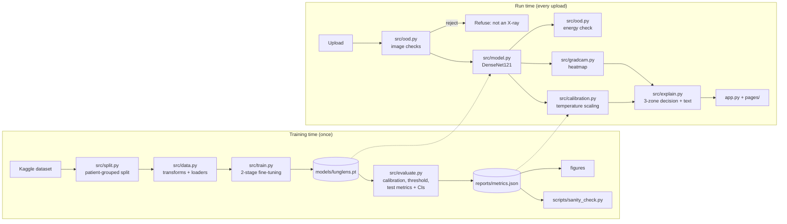

# LungLens walkthrough

This document is for explaining LungLens to judges: what it does, how every
file works, why each design decision was made, and the questions you are most
likely to be asked. Numbers quoted here come from `reports/metrics.json`,
`reports/sanity.json` and `reports/ood_eval.json`, which are produced by the
scripts, never typed by hand.

## 1. The pitch in 30 seconds

Pneumonia is the largest infectious killer of young children, and reading
chest X-rays needs experts that many hospitals lack. LungLens is a screening
aid: upload a chest X-ray and it returns (1) a Normal / Pneumonia / Inconclusive
result with a **calibrated** probability, (2) a **Grad-CAM heatmap** of where the
model looked, and (3) a **plain-language explanation**. What makes it
trustworthy rather than just accurate: it refuses images that are not chest
X-rays, says "Inconclusive" instead of guessing, is tuned to rarely miss
pneumonia, proves its heatmaps are meaningful with sanity checks, and states its
limitations openly.

## 2. Architecture



`src/predict.py` is the run-time pipeline in one class (`LungLensPredictor`);
the Streamlit files only display its output.

## 3. File by file

### Configuration and helpers
- **`config.yaml`**: every tunable number (paths, seed, image size, augmentation,
  learning rates, epochs, sensitivity target and threshold cap, Inconclusive zone, OOD
  thresholds). Nothing important is hidden in code.
- **`src/utils.py`**: loads the config, turns relative paths into absolute ones
  (`repo_path`), seeds all random generators (`set_seed`), picks CPU/GPU, reads
  and writes JSON. `LUNGLENS_DATA_DIR` lets the images live outside the repo.

### Data
- **`scripts/download_data.py`**: downloads the Kaggle dataset through Kaggle's
  REST API (token or legacy username/key) and extracts only
  `train|val|test / NORMAL|PNEUMONIA` images, skipping a duplicate folder and macOS
  junk inside the zip. It builds destination paths itself, so a malicious zip
  cannot write outside the data folder.
- **`src/split.py`**: re-splits the official training folder 80/20 into train and
  validation, **stratified** (same pneumonia share on both sides) and **grouped by
  patient** (all images of one patient on one side). Patient IDs are parsed from
  file names (`person1374_bacteria_3506.jpeg` -> `person1374`). The result is
  saved to `reports/splits.csv`, which is committed, so the split is reproducible.
- **`src/data.py`**: image transforms, the `Dataset`, the `DataLoader`s and class
  weights. Grayscale X-rays are copied into 3 channels because the backbone was
  pretrained on colour photos. Train-only augmentation: small rotation, mild
  zoom/crop, brightness/contrast. **No horizontal flip**, because a mirrored chest
  puts the heart on the wrong side.

### Model and training
- **`src/model.py`**: `LungLensNet` wraps torchvision's DenseNet121 (or ResNet50):
  `features -> final_relu -> average pool -> Linear(1024, 2)`. The separate
  `final_relu` module is the Grad-CAM target layer. Also checkpoint save/load and
  a file fingerprint (SHA-256) so the app can detect a weights/metrics mismatch.
- **`src/train.py`**: two-stage transfer learning. Stage 1 freezes the backbone
  and trains only the new head (fast, and protects the pretrained features from
  large early gradients). Stage 2 unfreezes everything with a 10x lower learning
  rate and a cosine schedule. Loss is class-weighted cross-entropy. After every
  epoch it measures validation AUROC and keeps the best checkpoint; it stops early
  after 3 epochs without improvement. The test set is never loaded here.
- **`notebooks/train_colab.ipynb`**: runs the *same* scripts on Google Colab, using
  the committed split.

### Evaluation and trust
- **`src/evaluate.py`**: runs the model once over validation and test, saves the
  raw scores (`reports/predictions.csv`), fits the temperature on validation,
  picks the threshold on validation, then reports test metrics with bootstrap
  confidence intervals and draws every figure **from `metrics.json`**.
- **`src/calibration.py`**: temperature scaling (one parameter, fitted with
  LBFGS on log-likelihood), reliability bins and expected calibration error.
- **`src/ood.py`**: the input guard. Layer 1 is image heuristics (size, colour,
  blankness, mostly-white, mostly-black, aspect ratio). Layer 2 is the energy
  score `-logsumexp(logits)` compared with the 99th percentile on validation
  X-rays. Its command line measures real X-ray statistics (`--stats`) and tests
  the guard on folders of non-X-ray images (`--eval`).
- **`src/gradcam.py`**: Grad-CAM from scratch with a forward hook (saves the
  feature map) and a tensor hook (saves its gradient), plus the heatmap overlay
  and the sanity-check helpers (border share, randomised model copy, Spearman
  correlation).
- **`src/explain.py`**: the 3-zone decision rule (normal / inconclusive /
  pneumonia), the six attention zones, and all user-facing wording. Chances are
  shown as whole percentages but never as 0% or 100%, and an empty heatmap is
  explained instead of pointing at a zone.
- **`src/predict.py`**: the run-time pipeline in order: guard, model, energy
  check, calibration, decision, Grad-CAM, explanation. Falls back to a clearly
  labelled `DEMO_MODE` (untrained network) when no weights are present.
- **`scripts/sanity_check.py`**: model-randomisation test, correct/incorrect
  examples and border-attention statistics -> `reports/sanity.json` + figures.
- **`scripts/make_samples.py`**: picks the bundled sample X-rays from the test
  set (clear cases, a borderline case, both kinds of error) and runs each one
  through the app's pipeline first, so every sample's title matches what the app
  shows.

### App
- **`app.py`**: the entry point. Sets the page layout and shared style, then shows
  the navigation menu and runs the chosen page (`st.navigation`).
- **`pages/screen.py`** (home): upload or sample, input check, result card with the
  calibrated probability and decision bands, side-by-side and overlay views with
  an opacity slider, plain-language explanation and a clinician view.
- **`pages/how_it_works.py`**: pneumonia on X-rays, pipeline diagram, Grad-CAM,
  calibration and the sensitivity-first idea in plain language.
- **`pages/model_performance.py`**: metrics with CIs, interactive threshold
  slider, ROC/PR/confusion matrix, calibration, training curves.
- **`pages/sanity_check.py`**: the three explanation sanity checks.
- **`pages/limitations_and_ethics.py`**: the model card.
- **`src/ui.py`**: shared Streamlit helpers: page setup, CSS, cached model
  loading (`st.cache_resource`), disclaimer, result card, probability meter.

### Tests and deliverables
- **`tests/`**: 92 pytest tests (data split, model and checkpoints, Grad-CAM
  range, hooks and library cross-check, input check, threshold, Inconclusive zone
  and metric logic, calibration maths, predictor timing and weights download,
  every page renders). They use an untrained model and synthetic images, so they
  run in about 20 seconds without the dataset.
- **`scripts/sync_results.py`**: copies the numbers from `reports/*.json` into the
  README and this document, and renders the judge questions below from
  `docs/templates/judge_qa.md`.
- **`scripts/make_code_pdf.py`**, **`scripts/make_one_pager.py`**: build the two PDFs.

## 4. Key decisions and why

| Decision | Why |
|---|---|
| DenseNet121, ImageNet-pretrained | Backbone of CheXNet (Rajpurkar et al., 2017); 7.0 million parameters (a 28 MB weights file), fast enough on a CPU. ResNet50 is one flag away (`--backbone resnet50`). |
| Patient-grouped split | Prevents the same child's images in train and validation, which would inflate validation scores (leakage). |
| Class-weighted loss | About 3 pneumonia images per normal one; without weights the model could score well by over-predicting pneumonia. |
| No horizontal flip | Chest anatomy is asymmetric (heart on the left); a flip creates impossible images. |
| Early stopping on validation AUROC | AUROC is threshold-free, so it measures ranking quality before any threshold is chosen. |
| Threshold chosen on validation for >= 95% sensitivity, capped at 0.5 | Screening should rarely miss a sick child; false alarms go to a clinician. The cap means an X-ray rated more likely pneumonia than not is never called normal (without it, this very confident model would have put the threshold much higher; the real value is in section 6). Choosing on validation keeps the test set honest. |
| Temperature scaling | One parameter, cannot change rankings (AUROC unchanged), easy to explain, standard (Guo et al., 2017). |
| Inconclusive band in odds | Scores near the threshold are the least reliable; saying "consult a clinician" is safer than a coin flip. The zone is defined on the odds (within a factor of 1.5 of the threshold's odds, i.e. 40%-60% around 0.5), so it can never run past 0% or 100% the way a fixed +/- 0.10 band can. |
| Two-layer OOD guard | Heuristics catch photos/documents cheaply and explainably; the energy score catches inputs the model itself finds unfamiliar. |
| Own Grad-CAM | Required by the brief, and it makes the method explainable line by line; a test cross-checks it against `pytorch-grad-cam`. |
| Bootstrap CIs | With 624 test images, point estimates alone overstate certainty. |

## 5. Results

Generated from `reports/*.json` by `python scripts/sync_results.py`; do not edit by hand.

<!-- RESULTS:START -->
Held-out official test set: **624 X-rays** (234 normal, 390 pneumonia), evaluated once. 95% CIs from 2,000 bootstrap resamples. Model `b901dd05afd1` (DenseNet121).

| Metric | At the operating threshold (0.50) | 95% CI |
|---|---|---|
| Sensitivity (recall) | **0.997** | 0.992 to 1.000 |
| Specificity | **0.402** | 0.339 to 0.465 |
| Precision (PPV) | **0.735** | 0.698 to 0.773 |
| F1 | **0.847** | 0.821 to 0.871 |
| Accuracy | **0.774** | 0.742 to 0.808 |
| AUROC | **0.950** | 0.929 to 0.969 |

- **Confusion matrix** at the operating threshold: 389 true positives, 1 missed pneumonia, 94 true negatives, 140 false alarms.
- **Calibration** (ECE, 15 bins; 0 is perfect): validation 0.017 -> 0.007, test 0.199 -> 0.173 after temperature scaling (T = 1.61, fitted on validation).
- **Inconclusive zone** [0.40, 0.60]: 3.4% of test X-rays; accuracy on the remaining ones 0.784.
- **Grad-CAM model randomisation:** Pass. With randomised weights the heatmaps change almost completely (mean correlation 0.00), so Grad-CAM reflects what the model learned, not just image edges.
- **Grad-CAM attention on the image edges:** Mostly reassuring. The median border share (28%) is below the 36% expected from evenly spread attention, so most heatmaps concentrate inside the image. 30 test X-rays (4.8%) still put more than 50% of their attention on the edges, and the app adds a caution message for results like those.

Input check, share of images warned or refused:

- chest X-rays (test set): 0.5% of 624 (0 refused, 3 warned)
- bone X-rays: 61.5% of 200 (37 refused, 86 warned)
- brain MRI: 27.5% of 200 (51 refused, 4 warned)
- photos and misc: 72.4% of 29 (20 refused, 1 warned)
- synthetic: 72.5% of 40 (29 refused, 0 warned)

 
<!-- RESULTS:END -->

## 6. Likely judge questions

Rendered from `docs/templates/judge_qa.md` by `python scripts/sync_results.py`, so every number in the
answers comes from the report files. Edit the template, not this block.

<!-- QA:START -->
### 1. "How well does it work?"

On the official test set (624 X-rays: 390 pneumonia, 234 normal), which was
never used for training, calibration or choosing the threshold, LungLens reaches **sensitivity 0.997**
(95% CI 0.992 to 1.000), **specificity 0.402** (0.339 to 0.465) and **AUROC 0.950** (0.929 to 0.969). In
plain numbers it missed 1 of 390 pneumonia X-rays and raised 140 false alarms on
234 normal ones. The intervals come from 2,000 bootstrap resamples. It is very good at
not missing pneumonia and weak at clearing healthy children (next question). These numbers describe this one
pediatric dataset; we have no external validation.

### 2. "Why is specificity so much lower on the test set than on validation?"

At the same threshold, specificity was 0.863 on validation but 0.402 on the test set: 140 of
234 normal test X-rays were flagged, 86 of them with at least 90% confidence. We report
this instead of re-tuning, because tuning on the test set would make every number on it meaningless. We cannot
prove the cause. Our validation images come from the official training folder, so they share whatever the
training images and labels have in common, and the test folder evidently differs. The dataset description
says that "the evaluation set was also checked by a third expert"; if that is the test folder, its labels may
follow a stricter standard than the training labels the model learned from. In practice it means the
threshold should be re-set on local data before LungLens is used anywhere, and that a flag is a reason for a
clinician to look, never a diagnosis.

### 3. "How did you choose the threshold?"

The rule was fixed *before* testing and applied to validation data only: take the highest threshold that still
catches 95% of pneumonia cases (sensitivity-first, because a screening tool should rarely miss
a sick child), but never go above 0.50. The cap exists because the model is very confident: the
95% rule alone allowed a threshold of 0.970, which would have called an X-ray
"normal" at any calibrated chance of pneumonia below that. The operating threshold is 0.500
(validation sensitivity 1.000, specificity 0.863). A false alarm costs a doctor's review; a miss can
delay treatment. The *Model Performance* page has a slider that shows the trade-off live; we did not change the
threshold after seeing the test results.

### 4. "How do I know the percentage it shows is honest?"

The raw network outputs are rescaled with **temperature scaling** (Guo et al., 2017): one number, T =
1.61, fitted on validation data only. The expected calibration error fell from 0.017 to
0.007 on validation, but only from 0.199 to 0.173 on the untouched test
set: calibration carries over only to similar images, and on the test folder the model stays over-confident,
mostly on normal X-rays it calls pneumonia. So the app calls the number a "calibrated chance" but never shows 0%
or 100%, and the *How it works* page tells users to read it as a rough guide. Prevalence matters too: the
training data is about three-quarters pneumonia, far more than a real screening population, so in practice the
true chance behind a given score would be lower.

### 5. "What does the heatmap actually show? Can I trust it?"

Grad-CAM (Selvaraju et al., 2017), which I implemented with two PyTorch hooks: one saves the last feature map,
the other its gradient with respect to the pneumonia score; the gradients are averaged into one weight per
channel, the weighted maps are summed, negative values dropped, and the 7 x 7 result is stretched over the
image. A test checks it against the `pytorch-grad-cam` library. It shows *where* the evidence was, not *why*.

To check it is not just an edge detector we ran the model-randomisation test (Adebayo et al., 2018) on
50 test X-rays: Pass. With randomised weights the heatmaps change almost completely (mean correlation 0.00), so Grad-CAM reflects what the model learned, not just image edges. (Mean rank correlation with the trained model's heatmap: 0.03
after randomising the final layer, 0.00 after also randomising the last dense block.)
We also measured attention on the image edges, where text markers sit: Mostly reassuring. The median border share (28%) is below the 36% expected from evenly spread attention, so most heatmaps concentrate inside the image. 30 test X-rays (4.8%) still put more than 50% of their attention on the edges, and the app adds a caution message for results like those. Normal X-rays lean on
the edges more than pneumonia X-rays (median border share 40% for correctly cleared normal X-rays,
27% for correctly flagged pneumonia): with little pneumonia evidence in the lungs, the map shows
whatever weak evidence exists, often at the borders.

### 6. "What happens if I upload something that is not a chest X-ray?"

Two layers. First, simple image checks with thresholds set from the statistics of the training X-rays only
(colour, contrast, blank or mostly white/black images, size, shape). Second, the model's **energy score**
(Liu et al., 2020): inputs the model finds unfamiliar get a warning. Measured on images the model never saw
(the share flagged, i.e. refused or warned):

  - chest X-rays (test set): 0.5% of 624 flagged (0 refused, 3 warned)
  - bone X-rays: 61.5% of 200 flagged (37 refused, 86 warned)
  - brain MRI: 27.5% of 200 flagged (51 refused, 4 warned)
  - photos and misc: 72.4% of 29 flagged (20 refused, 1 warned)
  - synthetic: 72.5% of 40 flagged (29 refused, 0 warned)

The guard is not perfect: other grayscale medical images are the hardest case, which is why the energy
check only warns and the disclaimer stays on screen. A small classifier trained to recognise chest X-rays
would be the next step.

### 7. "Your data is children from one hospital. Would it work on adults or other hospitals?"

We do not know, and we expect it to be worse. Every image comes from Guangzhou Women and Children's Medical
Center (ages 1-5). Pneumonia models are known to pick up hospital-specific cues and lose accuracy at new sites
(Zech et al., 2018). The next step would be an external test on an adult dataset such as RSNA Pneumonia
Detection or a different children's hospital, before any claim beyond this dataset.

### 8. "How did you avoid data leakage?"

Three rules. (1) The validation set is split **by patient** from the official training folder, so no child
appears in both (4,168 training / 1,048 validation X-rays). (2) The threshold, the temperature and
the energy threshold are all fitted on validation data. (3) The 624 test images were scored once, at the
end. One honest caveat: the file names show 170 patient numbers in both the official train and test
folders (320 test images), always with a different infection type, which suggests separate
numbering rather than the same child, but we cannot prove it from the file names alone.

### 9. "Why DenseNet121 and transfer learning?"

With about four thousand training images, learning from scratch would overfit. DenseNet121 pretrained on
ImageNet already detects edges and textures; we first trained only a new 2-class head with the backbone
frozen, then fine-tuned everything at a 10x lower learning rate, with early stopping on validation AUROC (best
checkpoint: finetune stage, epoch 6; 11 epochs in 106 minutes on a
4-core CPU). DenseNet121 is also the backbone of CheXNet (Rajpurkar et al., 2017), is small (about 7 million
parameters) and runs on a CPU: the full screening pipeline including Grad-CAM takes 0.35 s per image
(median of 10 runs on 1 CPU thread). ResNet50 is one command-line flag away.

### 10. "What does 'Inconclusive' mean, and how often does it happen?"

Scores between 0.400 and 0.600 are the least reliable, so the app says "Inconclusive: please consult a
clinician" instead of forcing a label. The zone holds every probability whose odds are within a factor of
1.5 of the threshold's odds; working on the odds means the zone can never run past 0% or 100%. On
the test set 3.4% of X-rays fall in that zone, and the accuracy on the rest is 0.784.
The single missed pneumonia X-ray scored 0.48, inside the zone, so the app would have asked for a clinician instead of saying normal. Both edges of the zone can be set in `config.yaml`.

### 11. "The dataset is imbalanced. Did that bias the model?"

About three pneumonia images for every normal one. We used class-weighted cross-entropy so each class counts
equally during training, report metrics that do not reward always saying "pneumonia" (specificity, AUROC,
precision), and set the threshold with an explicit rule on validation data, fixed before testing.

### 12. "Is this ready for clinical use?"

No. It would need external and prospective validation, a reader study against radiologists, subgroup
analysis (the dataset has no age, sex or ethnicity data), regulatory review as software as a medical device,
and monitoring after deployment. LungLens is an educational prototype that shows how such a tool can be built
to be honest about its uncertainty.

### 13. "What would you do with more time?"

External validation on adult and multi-hospital data, with the threshold re-set on local validation data;
better input checking (a small classifier trained to recognise chest X-rays); lung segmentation so attention
outside the lungs can be measured directly; and a radiologist review of the false alarms and the missed case.
<!-- QA:END -->

## 7. How to run

```bash
pip install -r requirements-dev.txt         # CPU torch: --index-url https://download.pytorch.org/whl/cpu
export KAGGLE_API_TOKEN=...                 # or KAGGLE_USERNAME + KAGGLE_KEY
python scripts/download_data.py             # ~1.2 GB of images into data/
python -m src.split                         # optional: reproduces reports/splits.csv
python -m src.train                         # 11 epochs, about 1 h 46 min on a 4-core CPU; much faster on a GPU
python -m src.evaluate                      # test metrics, calibration, figures
python -m src.ood --stats                   # X-ray statistics behind the input-check thresholds
python -m src.ood --eval "photos=/path"     # measure the input check on folders of other images
python scripts/sanity_check.py              # Grad-CAM sanity checks
python scripts/make_samples.py              # bundled sample images, each checked through the app
python -m src.predict assets/samples/sample_01.jpeg --benchmark 10   # CPU timing
python scripts/sync_results.py              # numbers into README.md and this file
pytest                                      # 92 tests
streamlit run app.py                        # the app
```
